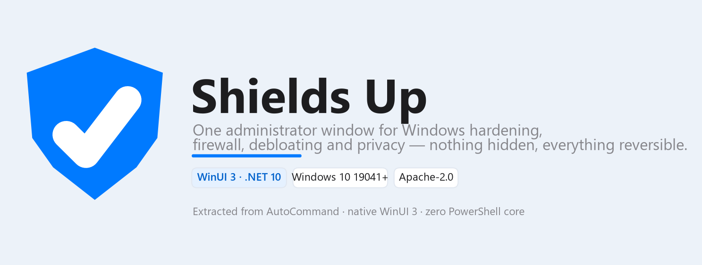
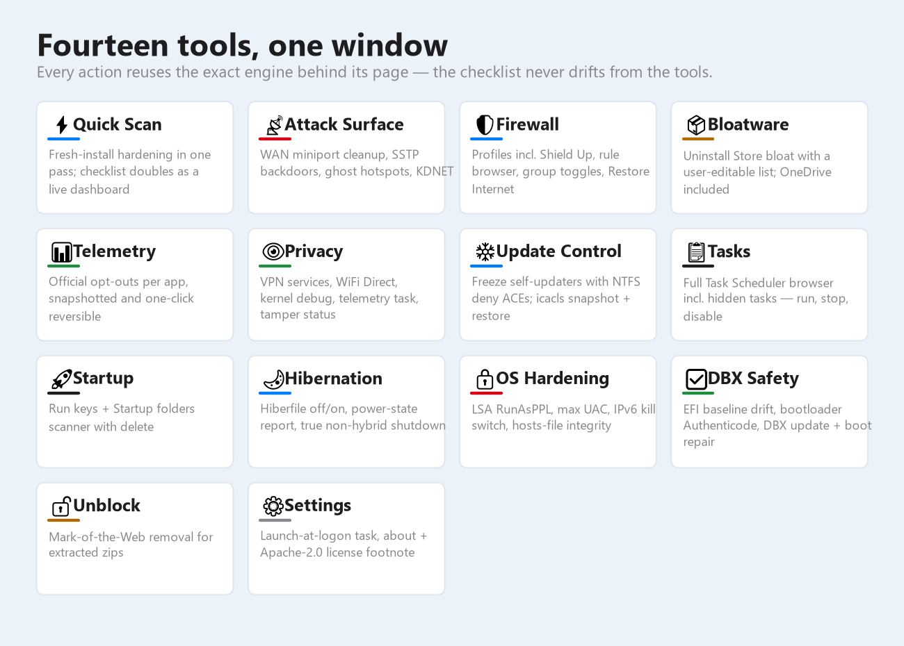
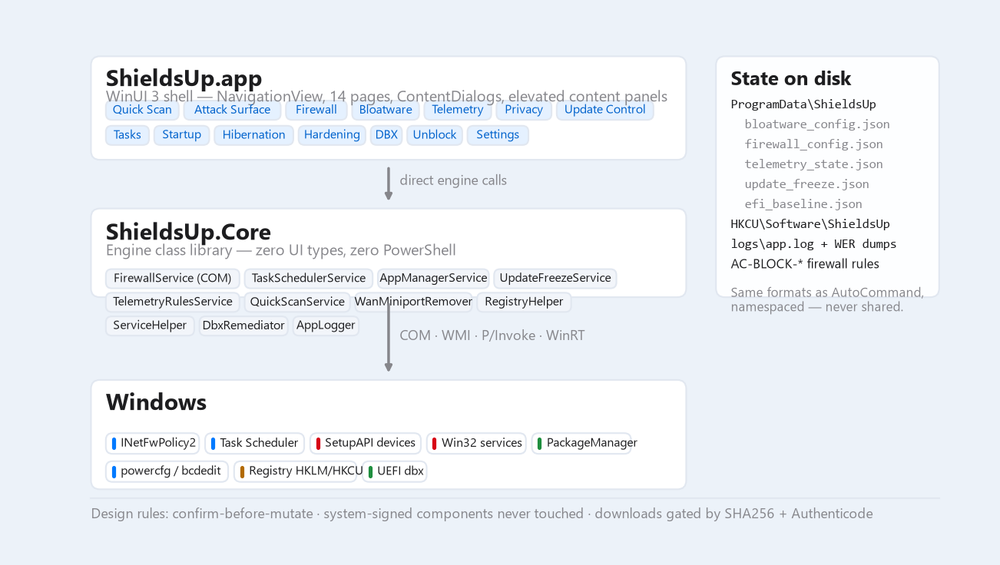

# Shields Up



**Shields Up** is a native Windows app (WinUI 3 / Windows App SDK on .NET 10) that puts
the system-control toolset of AutoCommand into one fast, always-elevated administrator
window: firewall profiles, attack-surface removal, bloatware cleanup, telemetry
opt-outs, update freezing, task and startup control, OS hardening, UEFI revocation
safety — with every action confirmed before it mutates and reversible after it does.

Unpackaged, ~90 MB self-contained, no installer, no background services, no telemetry.

---

## The tools



| Tool | What it does |
|---|---|
| ⚡ **Quick Scan** | One pass over a fresh Windows install — miniports, Shield Up firewall, telemetry task, IPv6 + UAC, logon task, bloatware, hibernation. The checklist doubles as a live status dashboard, and every step reuses the exact engine behind its dedicated page. |
| 📡 **Attack Surface** | Four lists: WAN miniport cleanup (top), SSTP/VPN backdoor neutering, ghost-hotspot (WiFi Direct) control, and KDNET kernel-debug removal. |
| 🛡 **Firewall** | Profile presets (Shield Up / Gaming / Office / Home / Public Strict) via `INetFwPolicy2` COM, inbound/outbound rule browser with group toggles, legacy `AC-BLOCK` rule migration, and a 🌐 **Restore Internet** panic button that disables the whole block-rule fleet at once. |
| 📦 **Bloatware** | Uninstalls Store bloat (Outlook, Xbox, Teams, Copilot, OneDrive, …) against a user-editable list — defaults ship with the app, your opt-outs and additions persist in JSON. |
| 📊 **Telemetry** | Applies each vendor's *own* documented opt-out (settings key, env var, or policy) for known phoning-home software, snapshots the previous value, and reverts exactly. Includes a DNS-cache "still beaconing?" check. |
| 👁 **Privacy** | VPN services (RasMan/IKEEXT/PolicyAgent/RemoteAccess), WiFi Direct adapters, kernel debug, the `UsageDataReceiver` scheduled task, Defender tamper-protection status. |
| ❄ **Update Control** | Freezes self-updating apps in place: NTFS deny ACE on the exe (delete/write denied, run untouched), original ACL saved with `icacls` and restored on thaw. Windows binaries are refused. |
| 📋 **Tasks** | Full Task Scheduler browser via COM — every folder including hidden tasks; run, stop, enable, disable, delete. |
| 🚀 **Startup** | Registry Run keys (HKCU + HKLM) and Startup folders, with delete. |
| 🌙 **Hibernation** | `powercfg` hibernate off/on, available-power-states report, and a true non-hybrid shutdown. |
| 🔒 **OS Hardening** | LSA `RunAsPPL`, UAC maximum strictness, the IPv6 kill switch (`DisabledComponents=0xFF`), and hosts-file integrity check + reset. |
| ✅ **DBX Safety** | Mounts the EFI partition, SHA256-baselines every boot file and reports drift, Authenticode-verifies the bootloader (Sysinternals sigcheck, downloaded only after signature gating), parses/applies Microsoft DBX revocation updates, and repairs the boot files with `bcdboot`. |
| 🔓 **Unblock** | Strips Mark-of-the-Web (`Zone.Identifier`) from this app's folder or any folder you pick — the fix for SmartScreen nagging on every launch of an extracted zip. |
| ⚙ **Settings** | Launch-at-logon scheduled task (highest privileges, no extra UAC prompt) and the about/license footnote. |

## Architecture



Two projects, one hard boundary:

```
ShieldsUp.slnx
└── src/
    ├── ShieldsUp.Core/   net10.0-windows classlib — every engine, zero UI types
    └── ShieldsUp/        WinUI 3 app — NavigationView shell + 14 pages
```

**Design rules**, inherited from AutoCommand's technical notes and enforced in code:

- **Zero-PowerShell core** — COM, WMI, P/Invoke and WinRT only; native CLI tools
  (`powercfg`, `bcdedit`, `schtasks`, `icacls`, `mountvol`, `netsh`) exclusively through
  one audited `ProcessRunner`. The single PowerShell exception is UEFI dbx application
  via `Set-SecureBootUEFI`, which has no native alternative.
- **Confirm-before-mutate** — every state-changing action goes through a confirmation
  dialog that says what will happen.
- **System-signed components are never offered for removal** — the bloatware and
  freeze engines refuse Windows binaries outright.
- **Downloads are integrity-gated** — SHA256 recorded, then Microsoft Authenticode
  verified before anything downloaded is executed; failures are deleted.
- **State is plain JSON** under `C:\ProgramData\ShieldsUp\` (`bloatware_config.json`,
  `firewall_config.json`, `telemetry_state.json`, `update_freeze.json` + ACL backups,
  `efi_baseline.json`) with preferences in `HKCU\Software\ShieldsUp`. Same file formats
  as AutoCommand, namespaced — the two apps never touch each other's state.
- **Diagnostics** — `AppLogger` writes sessions, navigations and every caught exception
  to `C:\ProgramData\ShieldsUp\logs\app.log`, and WER LocalDumps is registered so native
  crashes leave `.dmp` files in `logs\dumps`.

Firewall block rules use the shared `AC-BLOCK-*` naming vocabulary, so Shields Up's
Restore Internet button manages the same fleet AutoCommand created — safe on machines
that have run either or both.

## Visual design

The UI is a from-scratch WinUI 3 port of the EmojiWifi Windows reference: Apple-style
light theme — `#007AFF` accent, white sidebar with `#E5F1FF` selected pills, one
elevated rounded content panel per tab (thin `ThemeShadow` drop shadow), tinted inset
sections, and a white top bar that doubles as the window drag region.

## Build & run

Requires the .NET 10 SDK and Windows 10 19041+ (the app requests admin elevation).

```powershell
dotnet build ShieldsUp.slnx          # build
./publish.ps1                        # self-contained win-x64 folder + zip + SHA256SUMS
```

Output lands in `publish\v<version>\`, zipped as `ShieldsUp-v<version>-win-x64.zip`.

### Smart App Control / SmartScreen

Unsigned builds have no publisher reputation, so Smart App Control (when set to *On*)
may block a freshly built exe outright — there is no "run anyway" for that dialog.
For personal use, run a build SAC has already accepted or disable SAC (permanent per
Windows install). For distribution, sign the release: Azure Artifact Signing
(formerly Trusted Signing) at $9.99/month is the right-sized option for an app like
this — a `signtool` step in `publish.ps1` before the zip makes every build pass.

## License

Apache License 2.0 — see [LICENSE](LICENSE). Shields Up is derived from AutoCommand;
the derivation is recorded in [NOTICE](NOTICE).

---

Made with ❤️ in California · © 2026 Dan Park · MagicPoint.ai
